# What is new — 21 October 2026

Live screenshots of today's changes, taken from the running application in a browser. They were taken on a
**throwaway copy of the system** (its own empty database, `erp_shots`, seeded with sample people and one
sample import, then deleted) — nothing was added to the live database or to the development database.

## 1. Leads → Opportunities → Projects

Every client keeps **one number** (PIN-…) from the first contact to the project.

| | |
|---|---|
| 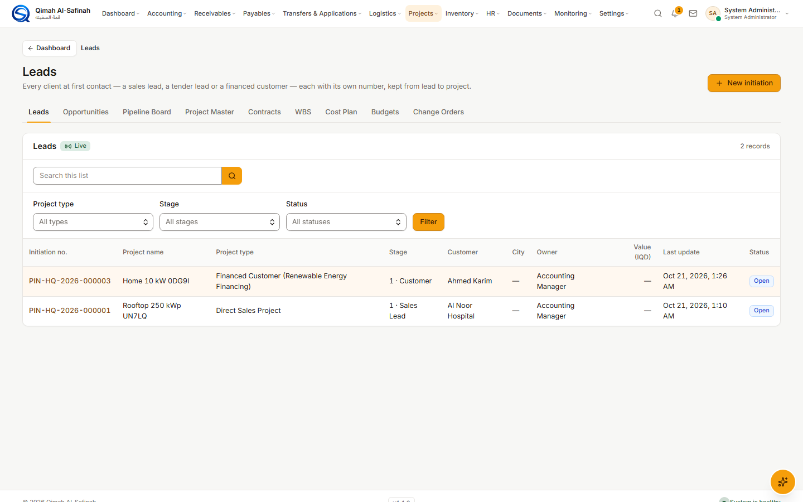 | **Leads** (Projects → Projects & Planning → Leads) — the clients at their first stage: a sales lead, a tender lead or a financed customer. *New initiation* opens a new one. The green **Live** badge means the list updates by itself. |
| 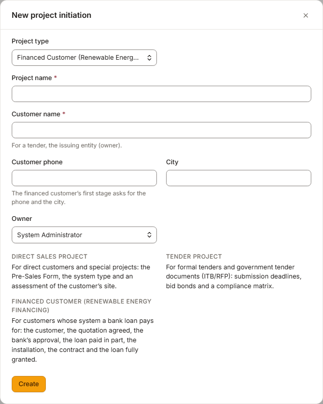 | *New initiation* now offers a third type, **Financed Customer (Renewable Energy Financing)**, and takes the phone and city at once. |
| 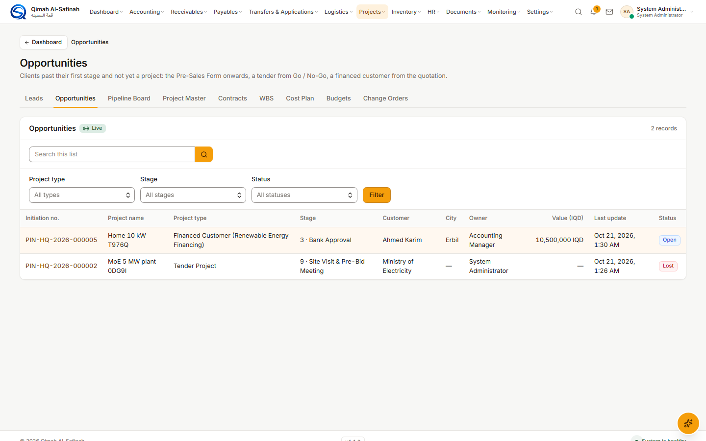 | **Opportunities** — the same records once they are past their first stage, until they become a project. Search by number, name, phone or city. |
| 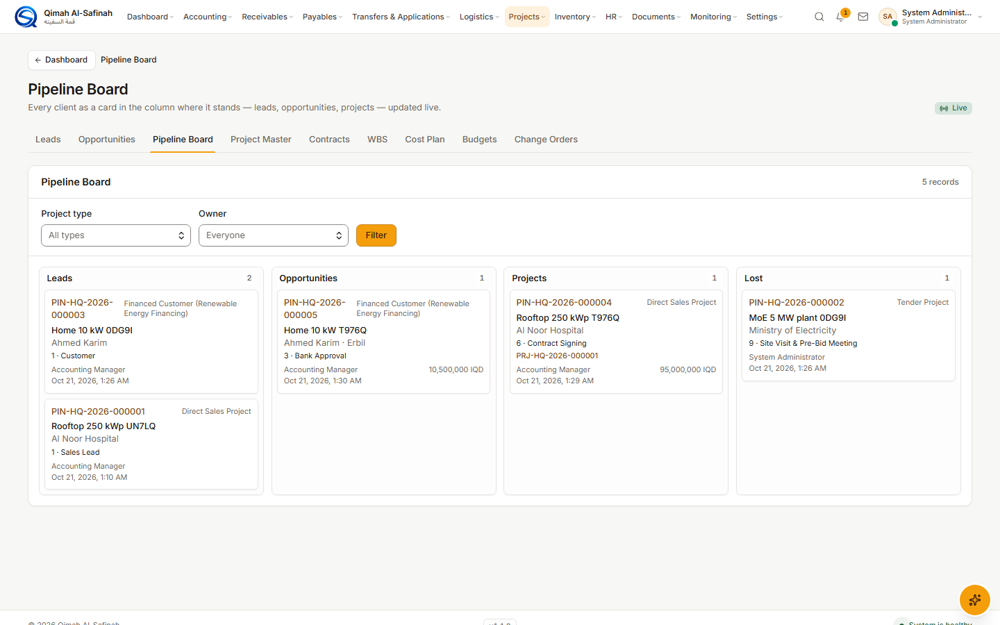 | **Pipeline Board** — every client as a card in its column: Leads, Opportunities, Projects, Lost. It moves cards by itself when a record moves. |
| 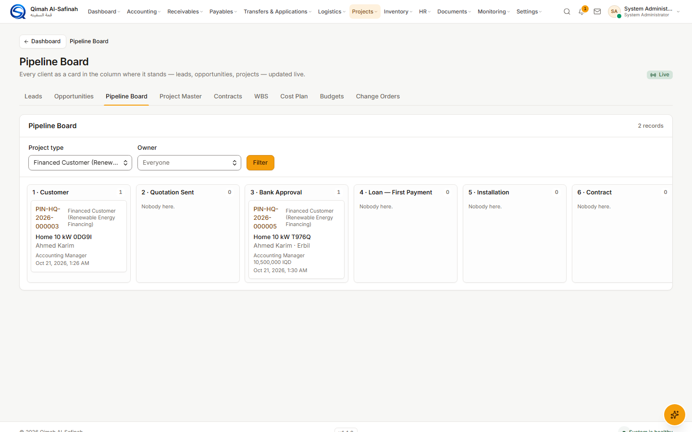 | Choose a type and the columns become its stages — here the seven of the financing road. |

## 2. The Renewable Energy Financing road

| | |
|---|---|
| 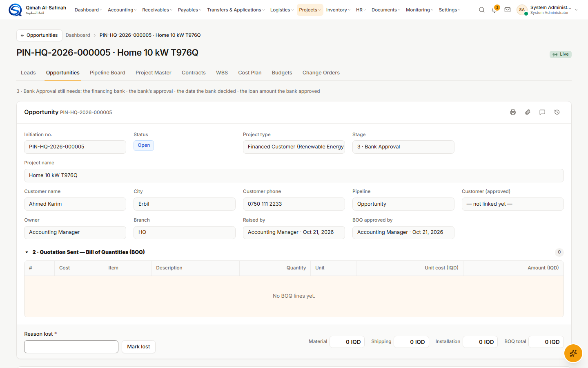 | A financed customer's record: the customer, city and phone in the header, its pipeline phase, the live badge. |
| 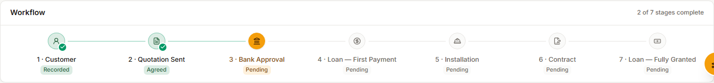 | The seven stages from the initiative's sheet. Under each stage reached, its outcome: *Recorded*, *Agreed / Refused*, *Approved / Rejected*, *Partially paid*, *In progress / Completed*, *Signed*, *Fully granted*. A stage moves on only on its good outcome. |
| 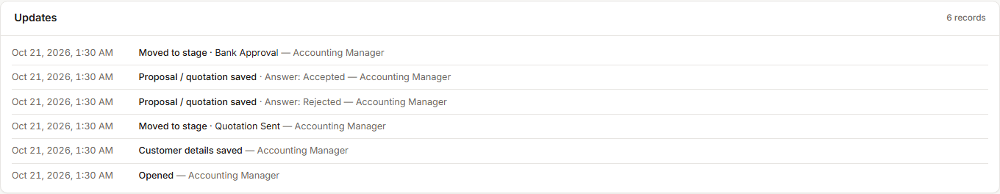 | **Updates** — every change of the record with who and when: the customer's answer, the bank's answer, the loan, the installation, each stage move. |

## 3. Live container tracking

| | |
|---|---|
|  | A container's page now has **Live tracking**: the last event, the vessel, the line's expected arrival beside our ETA (red when later), and every event the line gave. Refreshes every five minutes; **nothing is saved**. *In this picture the answer comes from a stand-in line that speaks the same DCSA standard as MSC, because the company's MSC key is not entered yet.* |
| 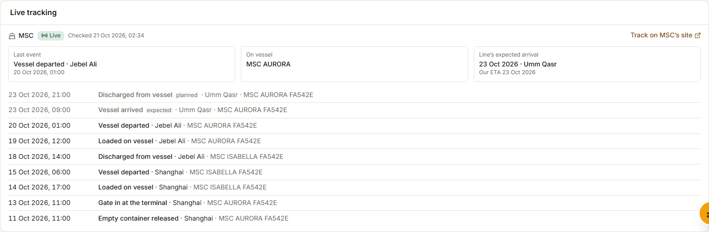 | A leased box (TGHU…) names no line; once the B/L says the shipping line, tracking follows it. |

## 4. Fix: sales invoices that would not post (COGS)

| | |
|---|---|
| 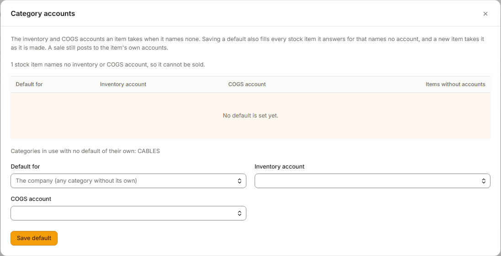 | Items → **Category accounts**: set the inventory and COGS accounts per item category and a company default. Saving fills every item that had none, and new items take them. The refused invoices can then be posted again. |

## 5. Arabic, on a phone

| | |
|---|---|
| 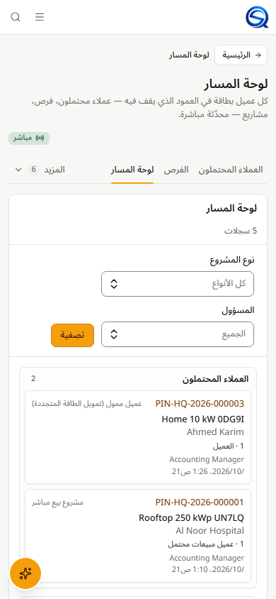 | The board in Arabic at a phone's width — columns stacked. |
| 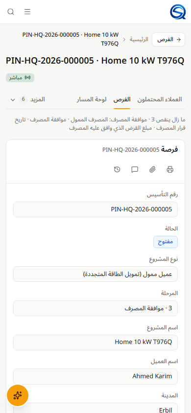 | A financed customer's record in Arabic on a phone. |
